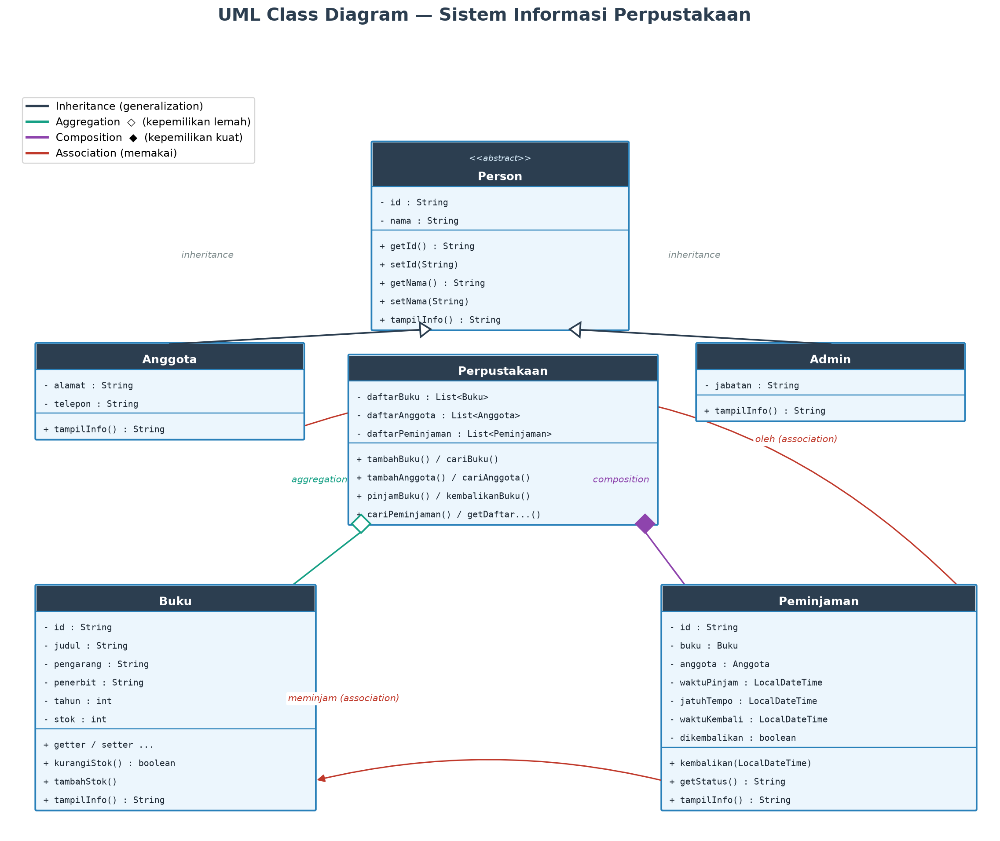
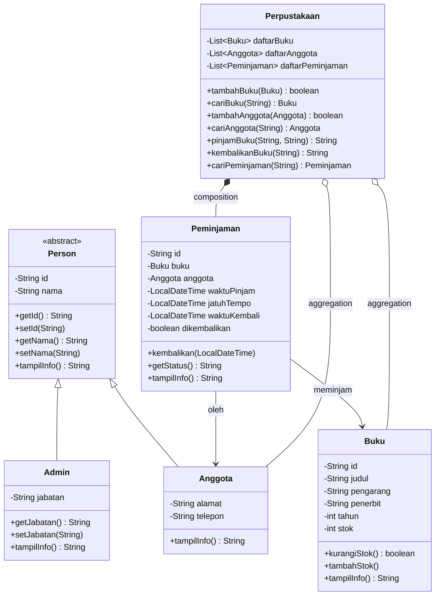
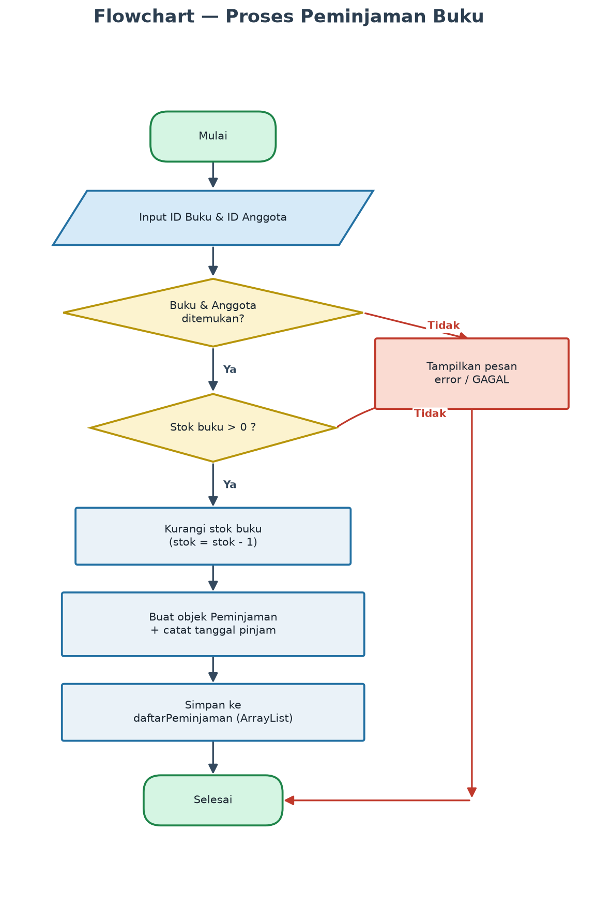
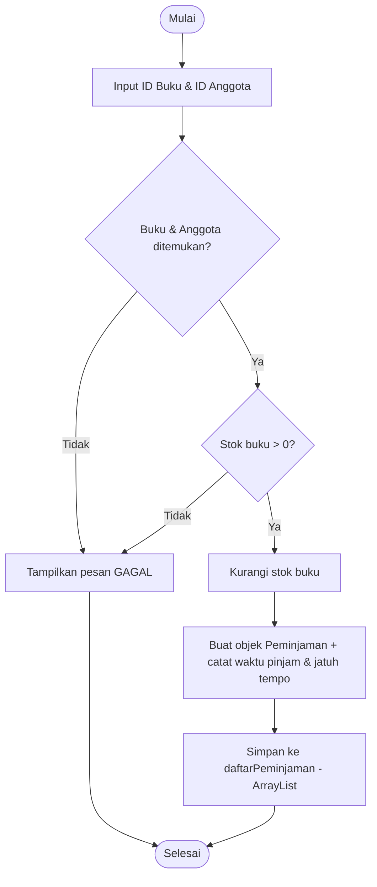

# Sistem Informasi Perpustakaan Digital — Analisis & Perancangan

Dokumen ini berisi **analisis permasalahan**, **identifikasi kebutuhan**, dan
**perancangan UML Class Diagram & Flowchart** untuk aplikasi pada repositori ini
(*Perpus — Tampilan Modern*). Perancangan disusun agar **sesuai dengan kode yang
benar-benar ada di repo** (package `perpustakaan`, `perpustakaan.model`, `perpustakaan.service`).

---

## 1. Analisis Permasalahan

### A. Identifikasi Permasalahan
Pada perpustakaan yang dikelola manual umumnya muncul masalah:

1. **Pencatatan tidak konsisten** — data buku/anggota rawan duplikat & salah ketik.
2. **Sulit melacak peminjaman** — tidak jelas buku mana yang sedang dipinjam, oleh siapa, dan kapan harus kembali.
3. **Tidak ada kontrol stok** — buku bisa dipinjam melebihi salinan tersedia.
4. **Rekap lambat** — laporan transaksi memakan waktu.
5. **Minim validasi** — input salah (ID tidak ada, format keliru, stok habis) tidak tercegah.

### B. Identifikasi Kebutuhan Pengguna (Aktor)
| Aktor | Kebutuhan |
|-------|-----------|
| **Admin / Petugas** | Menambah & menampilkan data buku dan anggota, mencatat peminjaman & pengembalian, melihat rekap transaksi. |
| **Anggota (Member)** | Dilayani peminjaman/pengembalian; memiliki identitas unik. |

### C. Data yang Dikelola
1. **Buku** — id, judul, pengarang, penerbit, tahun, stok.
2. **Anggota** — id, nama, alamat, telepon.
3. **Peminjaman (Transaksi)** — id, buku, anggota, waktu pinjam, jatuh tempo, waktu kembali, status.

### D. Proses Utama
1. Manajemen buku — tambah & tampil.
2. Manajemen anggota — tambah & tampil.
3. Peminjaman — pilih buku → pilih anggota → validasi stok → kurangi stok → catat transaksi + jatuh tempo.
4. Pengembalian — pilih transaksi → tandai kembali → tambah stok → cek keterlambatan.
5. Rekap — tampilkan seluruh transaksi beserta status.

### E. Solusi Aplikasi
Aplikasi **Java berbasis CLI dengan tampilan modern** (warna ANSI, dashboard, tabel teks) yang:
- Memodelkan tiap entitas sebagai *class* dalam package rapi.
- Menyimpan data dinamis memakai **`ArrayList`**; getter koleksi dibungkus `Collections.unmodifiableList` agar data internal aman dari perubahan luar (*encapsulation* tingkat koleksi).
- Menerapkan **encapsulation** (atribut `private` + getter/setter).
- Menerapkan **inheritance** (`Person` → `Admin`, `Anggota`) dan **polymorphism** (`tampilInfo()`).
- Mencatat waktu pinjam/kembali lengkap dengan **jam** (format `dd-MM-yyyy HH:mm`) dan **jatuh tempo** 7 hari.
- Memvalidasi input (format ID, telepon, stok, pilihan menu).

---

## 2. Perancangan UML Class Diagram

### A. Daftar Class, Atribut, dan Method (sesuai kode repo)

**`Person`** *(abstract)* — `perpustakaan.model`
- `- id : String`, `- nama : String`
- `+ getId()/setId()`, `+ getNama()/setNama()`, `+ tampilInfo() : String` *(abstract)*

**`Admin` extends `Person`**
- `- jabatan : String` · `+ get/setJabatan()` · `+ tampilInfo()` *(override)*

**`Anggota` extends `Person`**
- `- alamat : String`, `- telepon : String` · getter/setter · `+ tampilInfo()` *(override)*

**`Buku`**
- `- id, judul, pengarang, penerbit : String`, `- tahun, stok : int`
- getter/setter · `+ kurangiStok() : boolean` · `+ tambahStok()` · `+ tampilInfo()`

**`Peminjaman`**
- `- id : String`, `- buku : Buku`, `- anggota : Anggota`
- `- waktuPinjam, jatuhTempo, waktuKembali : LocalDateTime`, `- dikembalikan : boolean`
- `+ FMT : DateTimeFormatter` (konstanta format tanggal+jam)
- `+ kembalikan(LocalDateTime)` · `+ getStatus() : String` · `+ tampilInfo()`

**`Perpustakaan`** *(service)* — `perpustakaan.service`
- `- daftarBuku : List<Buku>`, `- daftarAnggota : List<Anggota>`, `- daftarPeminjaman : List<Peminjaman>`
- `+ tambahBuku()/cariBuku()/getDaftarBuku()`
- `+ tambahAnggota()/cariAnggota()/getDaftarAnggota()`
- `+ pinjamBuku()` · `+ kembalikanBuku()` · `+ cariPeminjaman()/getDaftarPeminjaman()`

### B. Hubungan Antarkelas
- `Admin` **--|>** `Person` — inheritance
- `Anggota` **--|>** `Person` — inheritance
- `Peminjaman` **-->** `Buku`, `Peminjaman` **-->** `Anggota` — association (menyimpan referensi)
- `Perpustakaan` **o--** `Buku`, `Anggota` — **aggregation** (kepemilikan lemah; objek dibuat di luar lalu dititipkan via `tambahBuku()`/`tambahAnggota()`)
- `Perpustakaan` **\*--** `Peminjaman` — **composition** (kepemilikan kuat; objek `Peminjaman` di-`new` **di dalam** `pinjamBuku()` dan tak bermakna tanpa perpustakaan)

#### Mengapa aggregation vs composition? (berdasarkan kode, bukan dipaksakan)
| Relasi | Siapa membuat objek? | Hidup mandiri? | Jenis |
|--------|----------------------|----------------|-------|
| `Perpustakaan`–`Buku` | dibuat di `Main`/seed lalu `tambahBuku()` | Ya | Aggregation ◇ |
| `Perpustakaan`–`Anggota` | dibuat di `Main`/seed lalu `tambahAnggota()` | Ya | Aggregation ◇ |
| `Perpustakaan`–`Peminjaman` | **`new Peminjaman(...)` di dalam** `pinjamBuku()` | Tidak | Composition ◆ |

Bukti dari `Perpustakaan.java`:
```java
public String pinjamBuku(String idBuku, String idAnggota) {
    ...
    // Peminjaman DICIPTAKAN di dalam Perpustakaan -> COMPOSITION
    Peminjaman transaksi = new Peminjaman(idTrx, buku, anggota, waktuPinjam, jatuhTempo);
    daftarPeminjaman.add(transaksi);
}
```

### C. Gambar Class Diagram


### D. Diagram (Mermaid — versi teks)


---

## 3. Flowchart Proses Peminjaman



#### Versi teks (Mermaid)

